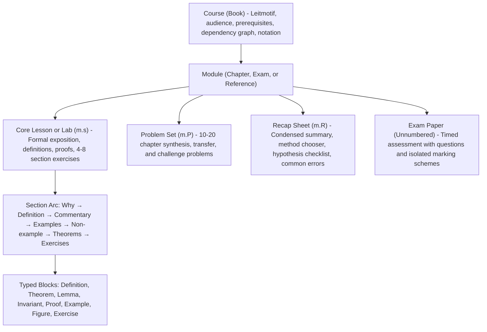

# Course Structural Grammar

This document defines LibreUni's universal structural grammar for courses, modules, pages, and semantic blocks, adapted from canonical university reference texts (Abbott, Martin, Huth & Ryan).

`COURSE_STANDARD.md` defines what content must achieve (the quality obligations). This document defines how that content is structured, typed, numbered, addressed, and navigated.

---

## 1. Structural Hierarchy

LibreUni models curriculum at four scales:



| Level | Physical Unit | Architectural Role | Reference Equivalent |
| --- | --- | --- | --- |
| **Course** | `course-manifests/<course-id>.yml` & `courses/<course-id>.json` | Book-scale learning journey with a central leitmotif and dependency structure | Reference textbook (e.g. Abbott *Understanding Analysis*) |
| **Module** | Manifest module entry (`modules: [...]`) | Thematic chapter, exam checkpoint, or reference appendix | Book chapter or exam checkpoint |
| **Page** | Single MDX document (`lessons/<course>/<slug>.mdx`) | Typed learning unit: `lesson`, `lab`, `problems`, `recap`, or `exam` | Section, problem set, recap sheet, or exam paper |
| **Subsection** | Markdown `## H2` | Navigable topic noun block | Section subsection |
| **Block** | Statement, Proof, Diagram, Figure, Exercise, Problem, Question | Addressable, typed semantic entity with generated numbering | Numbered theorem/example/figure/exercise |

---

## 2. Module & Page Kinds

Every manifest module and content document declares an explicit architectural `kind` conforming to a discriminated schema:

### Module Kinds

1. **`chapter` (Thematic Study Unit):**
   - The standard instructional chapter. Assigned sequential integer numbering ($m = 1, 2, \dots$).
   - Contains a sequence of `lesson` or `lab` pages, concluded by a chapter `problems` page and an epilogue `recap` page.
2. **`practice` (Comprehensive Self-Check Workshop):**
   - Interactive algorithmic problem generator module (`<PracticeGenerator>`). Unnumbered (`index: null`).
   - Contains solely `practice` pages.
3. **`exam` (Milestone Assessment Checkpoint):**
   - Formal examination module (e.g. Midterm, Final). Unnumbered (`index: null`).
   - Contains solely `exam` pages.
4. **`reference` (Course Appendix / Toolkit):**
   - Reference and notation compendia. Unnumbered (`index: null`).
   - Contains solely `recap` pages.

### Page Kinds

| Kind | Module Scope | Numbering / Label | Canonical Content & Components |
| --- | --- | --- | --- |
| `lesson` | `chapter` | $m.s$ (counts sections) | Theory exposition, `<MathStatement>`, `<MathProof>`, inline `<Quiz>`/`<CaseStudy>`, 4–8 `<Exercise>` items in `<ExerciseSet>`. |
| `lab` | `chapter` | $m.s$ (counts sections) | Hands-on constructive investigation (kernel traces, SQL playground, numerical engines) where code carries exposition. |
| `problems` | `chapter` | $m.\text{P}$ (does not increment $s$) | 10–20 deep synthesis problems in `<ProblemSet>` covering the chapter. Uses `<Problem>` and `<ExerciseSolution>`. |
| `recap` | `chapter` or `reference` | $m.\text{R}$ (does not increment $s$) | Hand-condensed summary sheet. Method chooser, hypothesis checklist with counterexamples, typical errors, thumbnail `<Figure>`. Uses `<Ref>` for all statements. |
| `practice` | `practice` | Unnumbered | Interactive algorithmic problem generator (`<PracticeGenerator>`) with randomized parameters, progressive hints, and step-by-step worked solutions. |
| `exam` | `exam` | Unnumbered (e.g. `Midterm`) | Timed examination paper. `<ExamAttempt>` interactive island, `<ExamQuestion>` items with points and sealed `<MarkingScheme>` disclosures. |

**Crucial Invariant:** `<MathStatement>` is permitted **only** on `lesson` and `lab` pages. `problems`, `recap`, and `exam` pages reference statements via `<Ref id="...">`; they never redefine them.

---

## 3. Section Arc (Core Lesson Blueprint)

Every `lesson` page must follow a disciplined internal sequence:

1. **The Motivating Question ("Why"):** Directly states the tension or problem that forces the introduction of the concept. No conversational filler or hollow welcomes.
2. **The Formal Definition:** The exact mathematical or technical statement, housed in a typed `<MathStatement kind="definition">`.
3. **Commentary & Alternative Formulation:** Deconstructs quantifiers, boundary values, and geometric or physical interpretations immediately following the definition.
4. **Worked Examples (≥ 2):**
   - *Example 1 (Canonical):* The standard operational case worked with full numeric values, register states, or algebraic terms.
   - *Example 2 (Edge / Variable):* A non-trivial case exercising boundaries (e.g., variable sensitivity, preemption window, non-linear bound).
5. **Non-Example or Counterexample:** A concrete case illustrating what fails when hypotheses or invariants are violated.
6. **Theorems, Properties & Derivations:** Structural claims (`kind="theorem"`, `kind="lemma"`, or `kind="invariant"`) paired with explicit proofs (`<MathProof>`).
7. **Concluding Section Exercises:** An `<ExerciseSet>` block gathering 4–8 typed, difficulty-graded exercises tied strictly to the section.

---

## 4. Block Taxonomy & Statement Architecture

All formal claims, definitions, and highlights belong to the unified Statement and Block system:

| Kind | Usage | Visual / Semantic Behavior |
| --- | --- | --- |
| `definition` | Formal definitions of concepts, terms, spaces, or data structures | Statement card with blue theme accent |
| `theorem` | Major structural results with significant implications | Highlighted statement card with theorem badge |
| `lemma` | Auxiliary result establishing a step toward a theorem | Statement card linked via `dependsOn` |
| `proposition` | Standalone technical result of moderate scope | Statement card |
| `corollary` | Direct consequence of a preceding theorem or proposition | Statement card |
| `invariant` | System rules, safety/liveness conditions, database constraints | Card with green/emerald integrity accent |
| `example` | Formal, titled worked example referenced across the lesson | Card with clean outline accent |
| `remark` / `convention` | Notation conventions, historical remarks, or commentary | Muted card |
| `warning` | Critical pitfalls, undefined behaviors, or failure conditions | Amber/red caution card |
| `proof` | Step-by-step verification, housed in `<MathProof for="...">` | Linked collapsible card with Q.E.D. symbol (`∎`) |

---

## 5. Numbering & Cross-Referencing

### Dynamic Numbering Contract

- **Never hardcode numbers:** Authors never type `number="1"` or `Definition 2.1` into source text, attributes, or headings (enforced by `LINT-06` and `LINT-08`).
- Numbers are assigned dynamically by the build system based on manifest module index, lesson order, and sequential item appearance:
  - Statements on lessons/labs: `Definition m.s.i`, `Theorem m.s.i` (shared per-lesson counter).
  - Exercises on lessons/labs: `Exercise m.s.i`.
  - Problems on problem sets: `Problem m.P.i`.
  - Figures: `Figure m.s.i` on lessons, `Figure m.P.i` on problems, `Figure m.R.i` on recaps.
  - Exam Questions: `Question i` (scoped to the exam paper).
- Non-chapter modules (`exam`, `reference`) have index `null` and do not consume chapter numbers.

### Resolvable Cross-References (`<Ref>`)

LibreUni replaces legacy isolated pages with **explicit, resolvable semantic dependencies**:

- **Banned:** Relative chronological navigation phrases (e.g., "in the next lesson", "as we saw yesterday", "before we move on").
- **Required & Encouraged:** Explicit semantic references to declared prerequisites and foundational statements:

```mdx
<Ref id="limit-definition" />
```

- When rendered, `<Ref id="limit-definition" />` resolves dynamically to its label and kind:
  *Definition 1.1.1 (Limit of a Function)*
- Clicking navigates directly to the anchor.
- Hovering or keyboard-focusing displays an instant preview card showing the block's mathematical content.
- Unresolved references fail the build with a descriptive error (`LINT-07`).

---

## 6. Heading Style Contract

- **`## H2` and `### H3` headings must use topic nouns:**
  - *Correct:* `## The Formal Definition of a Limit`, `## Quorum Intersection`, `## Cache Line Decomposition`
  - *Incorrect:* `## B+ tree navigation is an ordering proof`, `## Freeze the execution model before tracing`
- **Claims belong in statements:** When a heading previously stated a claim or theorem, the claim is housed in a `<MathStatement kind="theorem" ...>` block immediately beneath the noun heading.
- **No top-level `# H1` headings in MDX body:** The page title is rendered automatically by the layout from YAML frontmatter (`LINT-03`).
- **No raw Markdown horizontal rules `---` in MDX body:** Section boundaries are created by semantic headings or components (`LINT-03`).

---

## 7. Exercise Taxonomy & The Exercise / Problem Split

Practice is strictly bifurcated between section exercises and chapter problem sets:

### Lesson Exercises (4–8 items per lesson)
- Placed in `<ExerciseSet>` at the end of each `lesson` or `lab`.
- Focuses on immediate recall and application tied strictly to that section:
  - `verify`: calculate directly from the definition.
  - `negate`: construct the logical negation.
  - `construct`: synthesize an immediate instance.
  - `formalise`: translate prose into rigorous notation.
- Inline retrieval checks (`<Quiz>`, `<CaseStudy>`) remain adjacent to the concept.

### Chapter Problem Sets (10–20 items per chapter)
- Placed on a dedicated `problems` page in `<ProblemSet>`.
- Spans Bloom's higher cognitive levels across all lessons in the chapter:
  - **Transfer & Synthesis:** At least 3 problems at `transfer` or `synthesis` level (`generalise`, `prove`, `invented-definition`).
  - **Challenge (★):** At least 1 starred problem (`challenge={true}`).
  - **Cross-Lesson Integration:** At least 2 problems that synthesize two or more lessons in the chapter.
  - **Tool / Modeling:** At least 1 `tool` problem verifying a computational model or simulation.
- Every covered lesson must be the target of at least one problem.
- Every problem provides complete worked diagnostic steps in `<ExerciseSolution>`.

---

## 8. Statement-Proof Pairing & Disclosures

1. **Adjacent Proofs:** When a proof immediately follows its formal statement, do not render redundant jump links. Expansion occurs in-place terminated by `∎`.
2. **Collapsible Proofs by Default:** `<MathProof>` blocks are collapsible disclosures (`collapsible={true}`), promoting active retrieval before revealing derivations.

---

## 9. Mathematical Typography & Derivation Layout

1. **Vertical Breathing Room:** Display equations (`$$...$$`) must be used for algebraic steps, difference quotients, and limit evaluations. Never cram tall fractions or limits into single-spaced bullet lists.
2. **Case Separation:** Demarcate distinct logical cases (e.g. constant case vs non-trivial interior extremum) with bold case headers and empty line separation.

---

## 10. Verified Mathematical Figures

1. **Mandatory Figure Engine:** `<Figure id="...">` is **mandatory for graphs of real functions** in all courses. Hand-drawn TikZ curves using `plot`, `controls`, or coordinate approximations are strictly banned (`LINT-09`).
2. **Build-Time SVG Rendering:** All figures are defined as pure JavaScript specs under `src/figures/<course>/<id>.mjs` and rendered to standards-compliant, responsive SVGs at build time with `src/lib/plot/`.
3. **Mathematical Precision & Automated Verification:**
   - Every figure spec must define bounding window, adaptive sampling, and automated assertions (`checks`).
   - Figure tests (`tests/figures.test.mjs`) verify contracts A1–A9 on every build: monotonicity, non-overlap of labels, zero-crossing axis placement, viewport containment, and mathematical accuracy.
4. **Figure Variants:**
   - `<Figure id="fig-name" />`: Standard full-width figure with dynamic numbering and caption.
   - `<Figure id="fig-name" size="thumb" />`: Compact thumbnail for recap sheets and exercise prompts.
   - `<Figure id="fig-name" collapsed summary="..." />`: Collapsible disclosure for hints and solutions.
5. **Repair Over Deletion:** Existing figures and diagrams must be preserved and elevated to verified figure specs rather than discarded.
