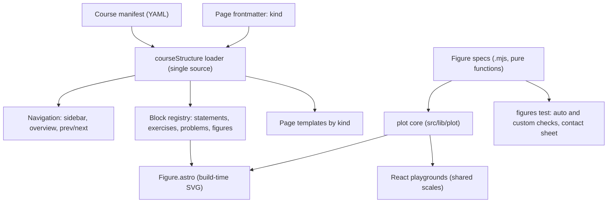

# Handover: page kinds (problem sets, recap sheets, exams) and verified figures

- **Status:** proposed design · 2026-11-07 · not implemented
- **Pilot:** `calculus-intro`, chapters 1 (Limits and derivatives) and 2 (Integration)
- **Builds on:** D-0012 (component architecture), D-0013 (structure and numbering), [`COURSE_STRUCTURE.md`](../agent-rules/COURSE_STRUCTURE.md)
- **Audience:** the agent who will implement this. Read the whole document before you edit anything.

This document is a work order. It does not change any rule. The rule changes it lists (Phase 5) take effect only after the repository owner accepts them and they are recorded as D-0014 in [`DECISIONS.md`](../agent-context/DECISIONS.md).

---

## 0. Why this exists

The owner has asked for two things.

1. **Better diagrams that are actually correct.** A previous agent added seven hand-written TikZ function graphs to the pilot chapter. They were wrong: tangent lines did not touch the curve, a "maximum" was not at the maximum, and the aspect ratios were distorted. When told they were broken, the agent deleted all of them and fell back to a `CodeRunner` with matplotlib. The pilot now has fewer visuals than before. The owner wants more and better figures, including small figures in exercises, hints, and solutions. Some of these may be collapsible.
2. **New page kinds.** Substantial exercise collections and similar material should get their own page. That page should appear in course navigation like a lesson, with a different icon. **Exams** and **recap (cheat) sheets** should be added as their own kinds, and exams may form their own module.

### 0.1 Root causes of the diagram failure (verified 2026-11-07)

These causes still exist. Your design has to remove them, not work around them.

| # | Cause | Evidence in the current tree |
| --- | --- | --- |
| R1 | **Coordinates are typed in by eye instead of computed.** Nothing ties a drawn tangent, extremum, or root to the function. | [`integration.mdx`](../../src/content/lessons/calculus-intro/integration.mdx) (Darboux TikZ near line 78) draws `plot[smooth] coordinates {…}`, which is a spline through six invented points, not a function. The rectangle heights are typed by hand. The upper-sum rectangles are drawn *after* the lower-sum rectangles and completely cover them, so the lower sum $L(f,P)$ is invisible apart from its outline. |
| R2 | **Shaded regions are approximated by polygons.** | [`applications-integration.mdx`](../../src/content/lessons/calculus-intro/applications-integration.mdx) (near line 37): the shaded area between $y=x$ and $y=x^2$ is a 6-vertex polygon, so it does not follow the curve. The curves also extend to $y=4.5$, past the drawn $y$-axis arrow, which stops at 4. |
| R3 | **Axes are decorative and drawn at fixed pixels, not at $x=0$ and $y=0$.** | [`plot.tsx`](../../src/components/playgrounds/plot.tsx) always draws the axes at pixel `x=76` and `y=276`. In [`TangentPlayground.tsx`](../../src/components/playgrounds/TangentPlayground.tsx), `xScale(-3)=76` and `yScale(y)=196-58y`, so the vertical "axis" is at $x=-3$ and the horizontal one is at $y\approx-1.38$. Both are visibly wrong for a cubic through the origin. |
| R4 | **The only verification is "does it compile".** | `TikZ.astro` checks only that LaTeX succeeds. `validate-course-visuals.mjs` checks only that the `code` prop is non-empty. No check compares a picture with the mathematics. |
| R5 | **Nobody looked at the rendered output.** | Neither earlier pass viewed the figures before reporting success. |
| R6 | **The rules point authors at the fragile tool.** | `COURSE_STRUCTURE.md` §10 says to use `<TikZ>` or native SVG for curves, tangents, and cusps, which is exactly the hand-coordinate path. |
| R7 | **Deleting everything was treated as a fix.** | Removing every figure "fixed" the visible defects and violated the visual-first obligation in §10. |

### 0.2 Other defects found while auditing the pilot

- **Exercise numbers are hard-coded** (`<Exercise … number="1">`) in `limits.mdx`, `derivatives.mdx`, and `mean-value-theorem.mdx`, despite D-0013's "never hardcode numbers". `Exercise.astro` takes `number` as a prop, and nothing generates it. LINT-06 covers only `<MathStatement>`.
- **The manifest has no way to express page kinds.** Six different consumers each parse `module.lessons` as a plain string array: [`lessons.ts`](../../src/utils/lessons.ts), [`statementRegistry.mjs`](../../src/utils/statementRegistry.mjs), `validate-rendered-lessons.mjs`, `validate-course-visuals.mjs`, `test_quality_contract.mjs`, and `test_validate_rendered_lessons.mjs`.
- **The `role` enum is never used.** The uncommitted `role` enum in [`content.config.ts`](../../src/content.config.ts) appears in no lesson or manifest.
- **Statement numbering depends on raw list position.** It is `module index . lesson index . item` ([`statementRegistry.mjs`](../../src/utils/statementRegistry.mjs)). If a problem set or recap page were inserted into a module today, every later lesson's statement numbers would shift.

### 0.3 Precondition: the dirty worktree

The worktree contains a large set of uncommitted D-0013 changes from the earlier agent: the rule packs, `COURSE_STRUCTURE.md`, `Exercise*.astro`, `Ref.astro`, `SummaryTable.astro`, the calculus lessons, and the lint and registry changes. **Do not discard or rewrite them.** Before you start, ask the owner to commit them, or confirm that you should build on top of them. Then record a baseline: run `npm run check:content` and note the result.

---

## 1. Design overview



The design has three independent parts. Phases 1–3 can be reviewed separately.

1. **Course structure:** page kinds and module kinds, one shared loader, and numbering that stays stable.
2. **Page templates:** problem set, recap sheet, and exam.
3. **Verified figures:** figure specs computed from real functions and rendered to SVG, with automatic mathematical checks and a mandatory visual review.

---

## 2. Course structure model

### 2.1 Page kinds

Each page declares `kind` in its frontmatter. The default is `lesson`, so all 75 existing lessons keep working unchanged. The manifest only orders and groups pages; it never repeats the kind.

| `kind` | Purpose | Sidebar icon (`lucide-react`, verified present) | Page label in numbers | Counts toward progress |
| --- | --- | --- | --- | --- |
| `lesson` | Section-scale exposition (today's lessons; covers D-0013 `discussion`, `core`, and `epilogue`) | `BookOpen`, plus section number | `m.s` (for example `1.2`) | yes, via "Mark complete" |
| `lab` | Constructive investigation where the exercises carry the exposition (D-0013 `project`/`lab`) | `FlaskConical` | `m.s` (consumes a section number) | yes |
| `problems` | Chapter problem set: deep, cross-lesson, tool, and challenge problems | `PencilRuler` | `m.P` | yes, done when the learner marks it complete; per-problem "solved" ticks are optional |
| `recap` | Condensed, printable recap or cheat sheet for a chapter or the course | `NotebookText` | `m.R` | no (reference material) |
| `exam` | Timed, self-marked examination paper | `GraduationCap` | none; titled "Exam: …" | yes, once an attempt is finished |

**Decision: replace `role` with `kind`.** Remove the unused `role` enum. D-0013's `discussion`/`core`/`epilogue` are all `lesson` pages. Their pedagogical arc is still governed by `COURSE_STRUCTURE.md` §2, which Phase 5 rewrites. `project`/`lab` becomes `lab`, and `assessment` becomes `exam`.

### 2.2 Module kinds

Each manifest module may declare `kind`. The default is `chapter`.

| Module `kind` | Contains | Numbered | Sidebar treatment |
| --- | --- | --- | --- |
| `chapter` | Any page kinds except `exam` | yes (`01`, `02`, …) | As today |
| `exam` | Only `exam` pages (for example "Midterm", "Final", "Practice exam A/B") | **no**, so it never shifts chapter numbers | Distinct band, `GraduationCap` icon, no number |
| `reference` | Only `recap` pages (a course-wide formula sheet) | **no** | `Library` icon, no number |

This covers both readings of the request. Exercise and recap pages sit inside chapters with their own icons, and exams (and optionally a course-wide cheat sheet) are top-level module types.

### 2.3 Manifest shape (pilot target)

Keep the existing `lessons:` key so the other three course manifests need no edits.

```yaml
modules:
- title: Limits and derivatives
  question: How do limits resolve the 0/0 quotient into a rigorous instantaneous rate of change?
  lessons: [limits, derivatives, mean-value-theorem, limits-derivatives-problems, limits-derivatives-recap]
- title: Integration
  question: How do Darboux partitions accumulate continuous quantities into exact areas?
  lessons: [integration, fundamental-theorem, applications-integration, integration-problems, integration-recap]
- title: Midterm examination
  kind: exam
  lessons: [calculus-midterm]
- title: Approximation
  question: How do higher-order derivatives construct polynomial approximations with bounded error?
  lessons: [taylor-series]
```

### 2.4 Numbering rules (must stay stable)

- `m` counts **`chapter` modules only**.
- `s` counts **`lesson` and `lab` pages only**, within the chapter. `problems` and `recap` pages do not use up a section index.
- Counters are kept per page:
  - Statements (one shared counter): `Definition 1.2.3`.
  - Exercises on lesson pages: `Exercise 1.2.4`.
  - Problems on problem pages: `Problem 1.P.4`.
  - Figures: `Figure 1.2.1`, `Figure 1.P.2`, `Figure 1.R.1`.
  - Exam questions: `Question 3`, scoped to the exam.
- `MathStatement` is allowed **only** on `lesson` and `lab` pages. Recaps, problems, and exams refer to statements with `<Ref>`; they never redefine them. This keeps the registry free of duplicates.
- **Regression gate:** after Phase 1, every existing statement number in all four courses must be identical to the baseline. Write the snapshot test *before* you change the loader (§6.1).

### 2.5 One loader for everyone

Add `src/lib/courseStructure.mjs` as plain ESM. It must be importable both by Node scripts and tests and by Astro. It exports:

```text
loadCourseStructure(courseId, { root }) → {
  modules: [{ index|null, kind, title, question, pages: [{ slug, kind, label, number, file, frontmatter }] }],
  pages: [...flattened in reading order],
}
```

- It parses the manifest and reads each page's frontmatter `kind` with the `yaml` package. It validates module and page kind compatibility and throws descriptive errors.
- Port every consumer listed in §0.2 to this loader. `statementRegistry.mjs` becomes a general **block registry** for statements, exercises, problems, and figures, numbered with the labels from §2.4. `Ref` then resolves any of them.
- `src/utils/lessons.ts` keeps its public API (`getCourseLessons`, `getLessonsByCourse`, `getLessonNavigation`) and attaches `kind`, `label`, `moduleKind`, and `moduleIndex` to each entry.

### 2.6 Content schema

Turn the `lessons` collection's schema into a discriminated union on `kind`. Keep everything in one collection so that routes (`/lessons/<course>/<slug>`), search, and the PDF pipeline keep working.

| kind | Required frontmatter beyond `title`, `course`, `description`, `estimatedMinutes` |
| --- | --- |
| `lesson`, `lab` | Current fields: `prerequisites`, `outcomes`, `omissions`, `assessment` |
| `problems` | `covers: [slug…]` (≥1, all in the same chapter), `outcomes` (≥1) |
| `recap` | `covers: [slug…]`; optional `omitStatements: [{ id, reason }]` |
| `exam` | `covers: [slug…]`, `durationMinutes`, `totalPoints`, `allowedMaterials: [string]`, optional `passMark` |

`LessonBrief` is shown only on `lesson` and `lab` pages. The other kinds get their own headers (§3).

---

## 3. Page templates

[`[...slug].astro`](../../src/pages/lessons/[...slug].astro) selects a header and body wrapper by `kind`. The shared parts stay the same for every kind: sidebar, prev/next navigation, and theme. The prev/next cards show a kind badge and icon, for example "Next · Problem set · Limits and derivatives".

### 3.1 Problem set (`problems`)

- **Header:** a covered-pages list (linked), outcomes, estimated time, and a legend for types, levels, and ★.
- **Body:** `<ProblemSet>` holding `<Problem id type level challenge covers>` items. `Problem` reuses the `Exercise` visual language and the `ExerciseSolution` hint and solution disclosures. Numbers come from the registry; there is no `number` prop.
- **Optional client island:** filter by level, type, or ★, and a per-problem "solved" tick stored in `localStorage` (`problem-solved-<course>-<id>`). Without JavaScript, every problem stays visible.
- **Split of exercises between lessons and problem sets.** This changes `COURSE_STRUCTURE.md` §7 in Phase 5.
  - A lesson ends with **4–8 section exercises**: recall and application (`verify`, `negate`, `construct`, `formalise`) tied to that section only. Inline `Quiz`, `CaseStudy`, and `CodeExercise` stay next to the concept they test.
  - A chapter's problem set holds **10–20 problems**: at least 3 at `transfer`/`synthesis` level, at least 1 ★, at least 2 that combine two or more covered pages, and at least 1 `tool` problem when the chapter has a playground or runner. Every covered page must be the target of at least one problem.
  - Move exercises; never duplicate them. If an exercise moves, its `<Ref>`s must still resolve (the lint already enforces this).

### 3.2 Recap sheet (`recap`)

- A chapter recap is **hand-condensed**, not generated. A recap is a compression, so copying statement bodies would defeat its purpose and would break on JSX inside statements. Each entry is a short paraphrase followed by `<Ref id>`, so hovering shows the exact statement.
- Required sections: *Definitions and results* (with `<Ref>`s), *Method chooser* (which tool for which problem shape), *Hypothesis checklist* (what fails without each hypothesis, with one counterexample each), and *Typical errors*. Small figures are allowed (thumbnail variant, §4.5).
- **Coverage contract (test):** every `definition`, `theorem`, `lemma`, `proposition`, and `corollary` in the covered pages is referenced on the recap or listed in `omitStatements` with a reason.
- **Print:** a two-column compact layout that fits on one A4 sheet per chapter, if possible. Check this with the PDF render. Screen layout stays one column on mobile.
- No `MathStatement`, no new claims, and no exercises.

### 3.3 Exam (`exam`)

- **Cover sheet:** duration, total points, allowed materials (normally "the recap sheets"), covered pages, and instructions.
- **Questions:** `<ExamQuestion id points covers>`, each with an optional `<MarkingScheme>` slot (a points breakdown plus a model answer).
- **`<ExamAttempt client:load>` island**, with these states: *not started → in progress* (optional countdown, can be paused, nothing is enforced) *→ finished*. Marking schemes are server-rendered with the `hidden` attribute. They are revealed **only on this exam page and only after the learner explicitly confirms "Finish attempt"**. After that, the learner enters a self-awarded score for each question, and the total is stored locally (`exam-attempt-<course>-<slug>`). "Start a new attempt" hides the schemes again.
- **D-0012 compliance:** there is no global or course-wide reveal, no `libreuni:exam-review` event, and no shortcut on lesson pages. Add an e2e test proving that lesson pages are unaffected (§6.4).
- **Print/PDF:** the questions print in the chapter flow, *without* marking schemes. All marking schemes go into a final appendix, "Marking schemes", so solutions never appear next to their questions.
- **Contract:** the sum of `points` equals `totalPoints`. Every slug in `covers` is the `covers` target of at least one question. Every question's `covers` is a subset of the exam's `covers`. No `MathStatement`. No hints. A question may reuse a figure.

### 3.4 Navigation surfaces

- **[`CourseSidebar.astro`](../../src/components/CourseSidebar.astro):**
  - Show a kind icon for each page, plus a visually hidden kind label (for example "Problem set: …") so screen readers announce it.
  - Number lessons only.
  - Exam and reference modules are unnumbered and drawn with a distinct border or tint taken from existing tokens.
  - Change the counter "Lesson X of N" to "Page X of N". Completion counts only the kinds marked "yes" in §2.1.
- **Course overview ([`[courseId].astro`](../../src/pages/courses/[courseId].astro)):** the same icons, with exam modules shown as checkpoint bands between chapters. Recap pages appear as a small "Recap" link on each chapter card, not as a full row.
- **Search index:** add `kind` and display it in results.
- **PDF ([`pdf-source.astro`](../../src/pages/courses/[courseId]/pdf-source.astro) and `tools/generate-course-pdfs.mjs`):**
  - Each chapter's lessons are followed by its problem set, then its recap.
  - Exam papers follow their position in the manifest.
  - Marking schemes go to the final appendix.

---

## 4. Verified figures

### 4.1 Principle

> A figure must be **computed from the mathematical objects it depicts**. An author never types a coordinate that the build could calculate. Every figure also passes automatic mathematical checks, and an agent or human looks at the rendered image before handoff.

### 4.2 Files and layering

| Path | Role |
| --- | --- |
| `src/lib/plot/scale.mjs` | Linear scales; nice ticks; `aspect: 'equal'` support; axes drawn **at $x=0$ / $y=0$** or, when zero is outside the window, as a labelled frame with ticks (never a fake axis) |
| `src/lib/plot/sample.mjs` | Adaptive sampling; breaks on non-finite values and on jumps larger than a threshold (no vertical "connector" lines at discontinuities); `exclude` intervals |
| `src/lib/plot/geometry.mjs` | `tangent`, `secant`, `solve` (bracketed bisection or Brent), `argmax`/`argmin` (golden-section on an interval), `riemann` (`lower`/`upper`/`left`/`right`/`mid`), `areaBetween` |
| `src/lib/plot/svg.mjs` | Pure function `renderFigure(spec) → { svg, warnings }`. String output with no DOM, so Node tests use it directly |
| `src/lib/plot/index.mjs` | `defineFigure` (schema validation) and re-exports |
| `src/figures/<course>/<id>.mjs` | One figure spec per file (default export) |
| `src/components/Figure.astro` | `<Figure id="…" />`: loads the spec through `import.meta.glob`, renders the SVG at build time, adds the generated number and caption, and registers itself for `<Ref>` |
| `src/components/playgrounds/plot.tsx` | Refactor `PlotFrame` to take scales from `src/lib/plot/scale.mjs`. This fixes R3 in every playground |

Use pure JavaScript and build-time SVG with no new dependencies. This avoids the LaTeX and Python toolchains, follows the theme through CSS classes, and can be tested in Node.

### 4.3 Spec format

```js
// src/figures/calculus-intro/fig-mvt-cubic.mjs
import { defineFigure, solve } from '../../lib/plot/index.mjs';

const f = (x) => x ** 3;
const df = (x) => 3 * x ** 2;
const a = 0, b = 2;
const m = (f(b) - f(a)) / (b - a);          // 4, computed
const c = solve((x) => df(x) - m, [a, b]);   // 2/√3 ≈ 1.1547, computed, never typed

export default defineFigure({
  alt: 'Graph of y = x³ on [0, 2] with the chord from (0, 0) to (2, 8) and the parallel tangent line at x = c ≈ 1.155.',
  caption: 'The tangent at c is parallel to the chord: f′(c) = (f(2) − f(0)) / 2 = 4.',
  x: [-0.3, 2.3], y: 'auto',
  curves: [{ id: 'f', fn: f, d: df, label: 'y = x³' }],
  marks: [
    { type: 'secant',  curve: 'f', from: a, to: b, label: 'chord' },
    { type: 'tangent', curve: 'f', at: c, span: 0.8, label: 'tangent at c' },
    { type: 'point',   curve: 'f', at: c },          // y computed from f
    { type: 'vline',   x: c, to: 'curve:f', label: 'c' },
  ],
  checks: [
    ['tangent slope equals chord slope', () => Math.abs(df(c) - m) < 1e-9],
    ['c lies strictly inside (a, b)',    () => a < c && c < b],
  ],
});
```

**Mark types (minimum set):** `curve` (with `domain`, `exclude`, `style`), `point` (on a curve by `at`, or `free: {x, y}` only for objects that are not curves; `open: true` for hollow endpoints and holes), `tangent`, `secant`, `hline`, `vline`, `segment`, `band` (horizontal ε-band), `window` (vertical δ-strip), `area` (between a curve and the axis or between two curves over `[a, b]`, filled with the same sampled path), `riemann` (`rule`, `n`, `interval`), and `label` (anchored to a mark and placed automatically). Also support `panels: [spec, …]` for small multiples. Parametric curves (needed for Cauchy's MVT) are optional in v1.

**Pitfall to cover in the spec docs and tests:** in JavaScript, `x ** (2/3)` is `NaN` for $x<0$. Use `Math.cbrt(x) ** 2`. Automatic check A2 catches this.

### 4.4 Automatic checks (run for every spec, in `tests/figures.test.mjs`)

| ID | Check |
| --- | --- |
| A1 | Schema is valid; `alt` (≥40 chars) and `caption` are present; the id is unique and matches the file name |
| A2 | Every curve is finite on at least 95% of its sampled domain outside `exclude`. Report the bad intervals |
| A3 | If `d` is given, it agrees with a central difference of `fn` at 50 points (relative tolerance 1e-4) |
| A4 | Every mark, label anchor, and point lies inside the viewport. Nothing is clipped |
| A5 | Label bounding boxes (estimated from character count and font size) do not overlap each other or a curve's point closest to the label anchor |
| A6 | Axes: if $0$ is in the window, the axis is rendered at the scaled zero. Assert this on the SVG output |
| A7 | `area` and `riemann` fills are drawn in a defined z-order (lower sums above upper sums, both translucent). This guards against the R1 overlay defect |
| A8 | Every custom `checks` entry returns `true` |
| A9 | Every `<Figure id>` in MDX resolves to a spec of the same course, and every spec is used at least once |

### 4.5 Rendering requirements

- Theme classes `lu-fig-series-1…4`, `lu-fig-accent`, and `lu-fig-muted` defined in `global.css` from existing tokens. Series must be distinguishable **without colour** (dash patterns or markers), and both light and dark themes must reach WCAG AA (the existing UX contrast suites will cover this once a figure page is added to them).
- `role="img"`, `<title>` and `<desc>` from `alt`, and a `<figcaption>` with the generated number.
- Fixed viewBox width (640). Rendered text must be ≥12 px at a 360 px mobile width.
- Variants:
  - `<Figure id size="thumb" />` for recaps and exercise statements.
  - `<Figure id collapsed summary="Show the graph" />` for hints and solutions. The disclosure is implemented inside the component, so LINT-01's raw-`<details>` ban is respected. In the PDF it is expanded.
- Optional and allowed in v1: KaTeX labels as an HTML overlay. Plain italic Unicode labels (`f`, `c`, `ε`, `δ`, `f′(a)`) are acceptable.

### 4.6 Where TikZ, PythonDiagram, and playgrounds still fit

- `Figure` is **mandatory for graphs of real functions** in all courses.
- Keep `TikZ` for constructions that are not function graphs (commutative diagrams, geometric constructions, trees). The new lint rule LINT-09 (§6.2) flags TikZ that contains `plot` or Bézier `controls`, or that draws axes plus curves.
- Keep `PythonDiagram` only for figures that need numerical libraries the JS core cannot provide.
- Playgrounds stay React, but they must use `src/lib/plot` scales and geometry so the static twin and the interactive view share one implementation.

### 4.7 Mandatory visual review (fixes R5)

- `npm run figures:preview` writes `reports/figures/<course>/<id>.svg` and an `index.html` contact sheet (light and dark side by side, with caption and check results).
- Add `tests/visual/figures.spec.mjs` to capture PNGs of the contact sheet at desktop and 360 px widths.
- **The implementing agent must open and look at every PNG it created or changed** before reporting. Use this checklist for each figure:
  - Does each tangent touch the curve at the marked point?
  - Are extremum and root markers where the curve turns or crosses?
  - Are the axes at zero?
  - Is anything clipped or overlapping?
  - Is it legible in dark mode?
  - Does the caption state exactly what is drawn?
- Record the review in the handoff, figure by figure.
- **Repairing is the only acceptable response to a broken figure.** If a figure is wrong, fix its spec. If it cannot be fixed, replace it with a stated reason. Removing figures in bulk is not a valid fix (R7).

---

## 5. Calculus pilot content (chapters 1–2)

All values below were verified by hand. The point is that they must be **computed in the spec**, not typed. The implementing agent re-derives each one and asserts it as a `checks` entry.

### 5.1 Figures to build

| Spec id | Page | Content | Must-pass custom checks |
| --- | --- | --- | --- |
| `fig-eps-delta-square` | limits | $f(x)=x^2$, $c=3$, $L=9$, $\varepsilon=1$, band $9\pm1$, window $3\pm\delta$ with $\delta=\min(1,\varepsilon/7)=1/7$; also show the optimal window $\delta^*=\sqrt{10}-3\approx0.162$ dashed | $\sup_{\lvert x-3\rvert<\delta}\lvert x^2-9\rvert = 43/49 < 1$; $\delta<\delta^*$ |
| `fig-squeeze-xsin` | limits | $x\sin(1/x)$ between $\pm\lvert x\rvert$ on $[-0.4,0.4]$, `exclude` $\lvert x\rvert<10^{-3}$, dense sampling | $\lvert f\rvert\le\lvert x\rvert$ at all samples |
| `fig-discontinuity-types` | limits | 3 panels: removable $(x^2-1)/(x-1)$ with an open point at $(1,2)$; jump $\operatorname{sgn}$-like step at 0 with open and closed endpoints; essential $\sin(1/x)$ | Open point $y$ equals the computed limit 2 |
| `fig-ivt-root` | limits | $x^3-x-2$ on $[1,2]$, line $y=0$, root marked | Computed root $\approx1.5214$ with $\lvert f(r)\rvert<10^{-9}$; $f(1)<0<f(2)$ |
| `fig-evt-failure` | limits | $f(x)=1/x$ on $(0,1]$ with an open left end; unbounded | Max over sampled domain grows as the left bound shrinks |
| `fig-secants-to-tangent` | derivatives | $x^2$ at $a=1$, secants $h=1,0.5,0.25$ (slopes $3,2.5,2.25$), tangent slope 2 | Each secant slope is $2+h$ |
| `fig-abs-corner` | derivatives | $\lvert x\rvert$ at 0 with one-sided secant slopes $\pm1$ | Left and right difference quotients differ |
| `fig-sqrt-linearisation` | derivatives | $\sqrt{x}$ near 4, tangent $L(x)=2+(x-4)/4$, error at 4.4 | $L(4.4)-\sqrt{4.4}\approx0.00238>0$ |
| `fig-rolle-cubic` | mean-value-theorem | $x^3-3x$ on $[-\sqrt3,\sqrt3]$, both $c=\pm1$ marked with horizontal tangents | $f(\pm\sqrt3)=0$; $f'(\pm1)=0$ |
| `fig-mvt-cubic` | mean-value-theorem | §4.3 example | $f'(c)=4$, $c=2/\sqrt3$ |
| `fig-mvt-cusp-failure` | mean-value-theorem | $x^{2/3}$ on $[-1,1]$ (`Math.cbrt(x)**2`), horizontal chord, no horizontal tangent | Chord slope 0; $f'\ne0$ on all samples $x\ne0$ |
| `fig-darboux-square` | integration | **Replaces the TikZ (R1).** $x^2$ on $[0,1]$, $n=4$, lower and upper rectangles both visible | $L=7/32=0.21875$, $U=15/32=0.46875$, $L\le1/3\le U$ |
| `fig-ftc-accumulation` | fundamental-theorem | 2 panels: $f(t)=t^2-1$ on $[0,2]$ with signed area to $x$; $A(x)=x^3/3-x$ with its minimum at $x=1$ | $A'(x)\approx f(x)$ at 50 points; argmin $A=1$ |
| `fig-area-between` | applications-integration | **Replaces the TikZ (R2).** Area between $y=x$ and $y=x^2$ on $[0,1]$, with the exact fill | Intersections computed at 0 and 1; numerical area $=1/6\pm10^{-6}$ |

Also fix the existing playgrounds:

- `TangentPlayground`, `EpsilonDeltaPlayground`, and `RiemannPlayground` move to the shared scales (R3).
- `RiemannPlayground`'s label "left Darboux sum" should read "left Riemann sum (equals the lower Darboux sum here because f is increasing)".
- Add model tests for each playground in `test:models`.

**Figures in exercises.** Place at least one collapsed figure in a hint or solution in each pilot lesson and each pilot problem set. Candidates:

- `ex-ivt-boundary`: $g(x)=x/2$ with the lines $u=0$ and $u=0.9$.
- `ex-mvt-boundary-failure`.
- `ex-limit-squeeze` (reuse `fig-squeeze-xsin` as a thumb).
- A Rolle-root exercise.

### 5.2 New pages

| Slug | Kind | Content |
| --- | --- | --- |
| `limits-derivatives-problems` | problems | Move the transfer, synthesis, ★, and `tool` exercises from `limits`, `derivatives`, and `mean-value-theorem` here (for example `ex-invented-quantifier-swap`, `ex-quotient-rule-proof`, `ex-disconnected-domain`, `ex-vector-mvt`, `ex-lhopital-circular`). Add cross-lesson problems, for example an ε-δ proof that a derivative exists, followed by an MVT bound. Reach 10–20 problems. Each lesson keeps 4–8 section exercises |
| `limits-derivatives-recap` | recap | Coverage of every definition and theorem in chapter 1 through `<Ref>`; method chooser (ε-δ vs limit laws vs squeeze; when MVT vs L'Hôpital); hypothesis checklist (EVT on an open interval, MVT with a cusp, L'Hôpital without the indeterminate form); typical errors |
| `integration-problems` | problems | Same pattern for chapter 2 |
| `integration-recap` | recap | Same pattern for chapter 2 |
| `calculus-midterm` | exam | About 120 min, 100 points, 6–8 questions spanning chapters 1–2: at least one ε-δ proof, one hypothesis-diagnosis question (counterexample required), one MVT inequality, one Darboux/integrability argument, one FTC application, and one transfer question not seen in the lessons. Allowed materials: the two recap sheets. Every question has a marking scheme with partial-credit lines |

All new prose follows `COURSE_STANDARD.md`, `GENERAL.md` (writing style, banned phrases), and `RESEARCH.md` (sources for any new factual claims). Exams and problem sets must be solvable from the covered pages alone.

---

## 6. Validation to add

Add tests and lint rules **before or together with** the code they guard. Never weaken an existing threshold.

### 6.1 Structure (`tests/course-structure.test.mjs`, added to `check:contract`)

- **Numbering snapshot:** commit `tests/fixtures/statement-numbers.json`, generated from the *current* registry before Phase 1. The test asserts that existing ids keep their numbers after the loader change and after the pilot inserts problem and recap pages.
- Module/page kind compatibility; every manifest slug exists; every page file is listed; frontmatter `kind` is valid; `covers` slugs are in the right chapter.
- `problems`, `recap`, and `exam` contracts from §3.1–3.3: counts, coverage, points sum, no `MathStatement`.

### 6.2 Lint (`scripts/lint_platform_consistency.mjs`)

| Rule | Rule text |
| --- | --- |
| LINT-08 | A `number=` prop on `<Exercise>`, `<Problem>`, `<ExamQuestion>`, or `<Figure>` is forbidden (D-0013). Introduce it only *after* removing the existing props in the same change, or `check:content` will fail |
| LINT-09 | `<TikZ>` whose code contains `plot`, `controls`, or axis arrows plus curve coordinates → error: "function graphs must use `<Figure>`" |
| LINT-10 | `<MathStatement>` on a page whose kind is not `lesson` or `lab` |
| LINT-11 | Unresolved `<Figure id>`; unused figure spec |

### 6.3 Figures

- `tests/figures.test.mjs` (A1–A9), added to `check:content`.
- `npm run figures:preview`.
- `tests/visual/figures.spec.mjs`, added to `check:visual`.

### 6.4 Browser

- **e2e:** the sidebar exposes the kind names to assistive technology; exam module headers are unnumbered; chapter numbers are unchanged.
- **Exam flow:** marking schemes are hidden, then visible after "Finish attempt", then hidden again after a new attempt. A lesson page has no reveal control.
- Add one problem page, one recap page, and the exam page to the axe and UX route lists in both themes.

---

## 7. Phases and acceptance criteria

| Phase | Scope | Done when |
| --- | --- | --- |
| 0 | Preconditions (§0.3); baseline checks recorded | Owner confirms; baseline `check:content` result noted |
| 1 | `courseStructure.mjs`, schema union, block registry, all six consumers ported; **no content changes** | Numbering snapshot identical; `check:content` and `check:build` pass |
| 2 | Kind-aware sidebar, overview, prev/next, search, page headers; skeleton `problems`/`recap`/`exam` templates and components; PDF ordering and marking-scheme appendix | `check:e2e`, `check:ux`, and `check:visual` pass; screenshots of the sidebar, a problem page, a recap page, and the exam page reviewed in both themes and at mobile width |
| 3 | `src/lib/plot`, `Figure.astro`, figures test, preview, LINT-09/11; playgrounds moved to shared scales | A1–A9 pass on the three ported playgrounds plus at least two test specs; contact sheet reviewed |
| 4 | Pilot content §5; LINT-08 together with the removal of hard-coded numbers in chapters 1–2 (and in any other files the rule hits) | All §5 checks pass; every figure is reviewed visually and the review recorded; integrity and pedagogy audits run; numbering snapshot still holds |
| 5 | Rules: rewrite `COURSE_STRUCTURE.md` §2 (kinds), §7 (exercise split), §10 (Figure mandatory, review duty, no bulk deletion); add `COURSE_COMPONENTS.md` entries for `Figure`, `Problem`/`ProblemSet`, `ExamQuestion`/`ExamAttempt`/`MarkingScheme`; add the new checks to `VALIDATION.md`; draft D-0014 (amends D-0013 roles) for owner acceptance | Owner accepts D-0014 |
| 6 | Independent verification by a different agent (D-0007: writers ≠ verifiers) | `check:required` passes, and an independent review of chapters 1–2 finds no mathematical or figure defects. Only then are other chapters or courses scaled |

---

## 8. Anti-patterns (each one has already happened)

- Typing coordinates for a curve, tangent, extremum, root, or rectangle.
- Reporting success without opening the rendered images.
- Answering "the diagrams are broken" by deleting them, or by converting interactive components into static text.
- Adding a figure without `alt`, without a caption stating its claim, or without a check for that claim.
- Inserting a page into a manifest and shifting every later statement number.
- Adding a reveal-all or exam-mode toggle that reaches beyond a single exam page.
- Duplicating an exercise in a lesson and in a problem set instead of moving it.

## 9. Open decisions for the owner

The defaults below are what this document assumes. Change them before Phase 1 if needed.

1. Problem and recap pages live **inside chapters** (sidebar items with icons). Exams, and optionally a course-wide formula sheet, are **unnumbered module kinds**.
2. Exam marking schemes unlock per exam after an explicit "Finish attempt", with self-marking. Nothing is graded on a server.
3. Recaps are hand-condensed with a coverage test, rather than auto-generated from statement bodies.
4. Lessons keep 4–8 section exercises, and the deep, cross-lesson, and ★ problems move to the chapter problem set.
5. Exams count toward course progress. Whether a finished exam can later serve as a career-path gate (`careers/*.json` `gate.lesson`) is deferred.
